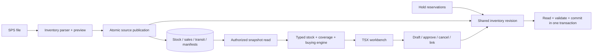

# Purchasing implementation — October 25, 2026

The owner authorized a clean Purchasing redesign, reliable file-driven stock
coverage, incoming containers and purchase workflow. The entry remains Inventory
Analysis → Purchasing. Existing React/Vite, Node 24/Express, MongoDB, Zod and
Socket.IO remain; no additional runtime dependency was introduced.

## User experience

- **Stock overview:** exact color/variant, reported sales, total physical SPS
  slabs, allocated slabs, other unavailable stock, available slabs, incoming
  containers, exact days of cover, selected-day balance and next stock action.
- **Incoming containers:** searchable color/PO/container/supplier, destination,
  slabs/quantity, reported ETA and optional expected warehouse receipt date.
  Upload the original SPS `.xls`, `.xlsx`, CSV or text report directly.
- **Purchase drafts:** active drafts appear first; paginated history remains
  reachable. Draft, approve, export, cancel and link the resulting new SPS order.
- **Settings & sources:** warehouse/report selection, source evidence, optional
  supplier/bundle/weight/container settings and the legacy open-PO adapter.

Low-cover sorting is the default. Other sorts include reported sales and color.
The forecast accepts 1–365 days with 1/2/4/5/10/30/60/90-day shortcuts. Review CSVs
include current stock, allocations, coverage, selected horizon, incoming counts,
unknown values, source dates and purchase requirements. Mobile tables become
cards; navigation uses a two-column layout. Canonical black/white/gold tokens,
FormModal, shared calendar and 25/50/100-row pagination are retained.

Stock results do not require supplier or container settings. Purchase planning
requirements are collapsed; detailed setup lives under Settings & sources.
Uploading from Purchasing keeps the user in Purchasing and refreshes immediately.

## Ownership and flow

Inventory owns file parsing and published source facts. Purchasing owns buying
settings, deterministic plans, drafts, locks and links. A posted approval is an
internal record; no supplier order is transmitted automatically.

Production purchasing code in `src/purchasing` now uses `.ts`; all Purchasing
screens/components use `.tsx`. Sales and stock/transit models and publication
services use `.ts`. Legacy API test fixtures remain JavaScript; unrelated
inventory and repository migrations retain their separate plan.

## Calculation contracts

- Daily demand = reported quantity / inclusive report days. Completed reports
  supply their period automatically; upload time is audit metadata. A report
  requesting future dates still needs the actual last sales date it contains.
- One `stockBreakdown()` drives display, cover and buying availability. It
  excludes non-SLAB products, commitments, remnants and app reservations once.
  Duplicate/missing serials, unknown statuses and inconsistent quantities block
  automatic buying as well as numeric stock coverage.
- Stock lasts = available SF / daily SF demand. Selected-day balance = available
  SF − daily SF × days. Incoming supply is displayed separately. Historical or
  unconfirmed scope evidence can produce a labelled estimate without enabling
  a purchase. Missing numeric inputs or ambiguous branches remain unknown.
- With no reported sales, show that fact instead of an invented days value;
  the forecast retains the available balance. SF, EA and supplier slab
  equivalents remain distinct.
- Buying compares 60/90-day usable delivery plus review/buffer policies. It nets
  dependable receipts in the applicable horizon and rounds to supplier bundles
  and minimums. Unknown/overdue receiving dates need reconciliation for buying.

## Source lifecycle and command consistency

All stock/sales/transit publications, hold-reservation changes, source/policy
updates and purchasing commands acquire `InventoryRevision` first inside their
transaction. Source reads, fingerprint checks, locks and command writes then
commit together. Conflicts retry against current sources. Plans and approved
exports read coherent snapshots. Cancellation does not depend on a healthy
sales report or a successful planning calculation.

Stock replacement retains its existing recovery backup. Sales replacement is
atomic, with stable logical report identity separated from source revision.
Replacing a report preserves the warehouse view and policies while invalidating
its old full-coverage evidence. Existing content-derived report references are
resolved on read and backfilled transactionally during replacement.

Transit publication records branch coverage, complete/partial mode, source
filename/hash, import metadata and history. A complete report archives absent
shipments as **not reported**, without inferring receipt. Partial reports retain
other shipments. An empty complete report requires explicit branches and an
empty-report confirmation. Publishing a failed report leaves the previous
source and revision intact. Preview/apply retains the same server-side file
identity, owner and expiration; users do not copy/paste source rows.

Reported SPS ETA never automatically confirms usable supply. A manager may set
an expected warehouse receipt date for a PO/container group. Its source-content
signature, actor and time are retained; a changed shipment clears confirmation.
Known containers, missing IDs and unknown slab counts remain distinguishable.

PO parent and shipment supply are reconciled once. Draft creation snapshots
existing PO lines and raw-transit parent identities. Linking cannot claim an
order already present when the draft was calculated, including older drafts
whose saved receipt keys establish that parent identity.

## Loading and freshness

The hook loads stock plans, drafts and open-PO details independently. An auxiliary
failure never hides a successful stock plan. Data remains in session memory for
five minutes; authentication and imports share Inventory's invalidation boundary.
A small revision request checks for changes every 30 seconds and on visibility /
reconnect. A source change, freshness boundary or Pacific date rollover triggers
new data. Returning to the tab restores results immediately and checks revision;
it does not request the entire catalog again. Server commands always revalidate.

## Validation

Regression coverage includes duplicate/sample stock, raw versus confirmed ETA,
complete/partial/empty transit reports, failed-publication rollback, sales report
replacement/backfill/rollback, old-PO linking, concurrent source publication and
approval, draft history beyond 100, resource failure isolation and selected-day
exports. Existing holds and stock-publication regressions are included.

Browser validation uses the original `In-Transit.xls` against a disposable
MongoDB, the actual APIs and actual TSX screens. It reads/stores all 607 product
lines, including 91 Seattle lines in 66 PO/container groups and six Enigma SJ MQ
3CM groups. It exercises receiving-date save, restored tabs, auxiliary failures,
both themes and 390px / desktop layouts without page overflow or runtime errors.
Production data is not changed by these checks.

Integrated validation: 2,199 tests passed across 164 files (four existing
skips); strict typecheck, native server imports and production build passed.
All 25 Purchasing render tests also pass after the final product-removal fix.
Direct evaluation of the provided stock, Seattle sales and transit files reads
11,235 stock rows, 244 sales rows and 607 incoming lines. It derives the
273-day report period and numeric cover for all five requested example colors,
without supplier policies or manual date confirmation.
The complete Inventory Analysis parent was also exercised in the browser;
imports stayed in Purchasing and refreshed without relying on Socket.IO.
Existing draft status/history/locks are retained. Approval and export require
current fingerprints under the updated engine; an obsolete draft must be
recreated. No production records are repaired or deleted during deployment. Broader Inventory
corrections, a unified PO ledger replacing the legacy adapter, receipt-to-stock
identity reconciliation, source-history/recovery UI and comparable historical
trend analytics remain separate work; this implementation does not invent
missing SPS line IDs, supplier weights or daily sales history.
