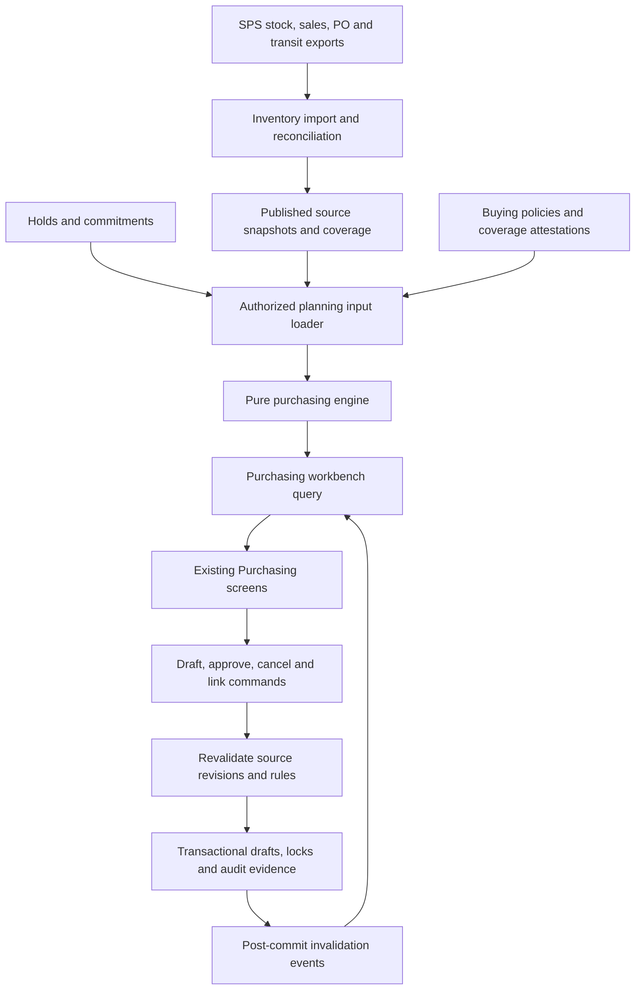
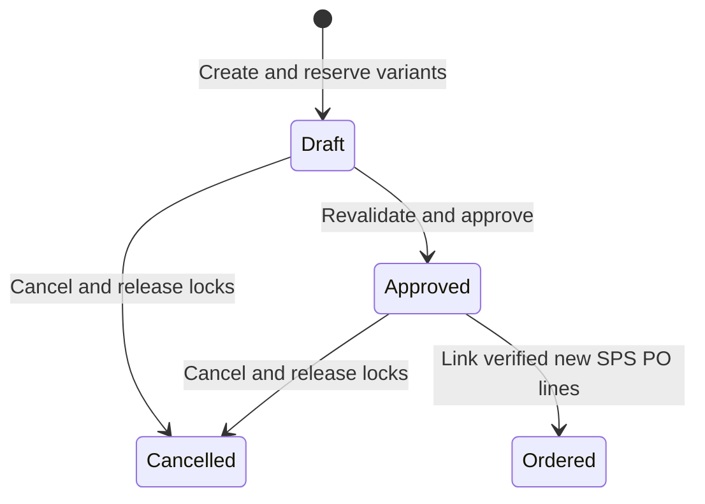

# Purchasing module architecture

Status: proposed design, based on the current implementation. Runtime changes
are delivered separately in the order recorded in `INVENTORY_MODULE_PLAN.md`.
The owner requested this design after the stock publication and tab-return
corrections. This document does not mark the migration or outstanding fixes done.

## Purpose and boundaries

Give a buyer a defensible answer to four questions: what needs replenishment,
how much, when it must be usable at the destination, and which supplier/container
can deliver it. Preserve the current Inventory Analysis → Purchasing entry,
Buyer queue, Color performance, Container drafts and Data & planning rules.

Use the existing React/Vite frontend, Node 24/Express backend, Mongoose/MongoDB,
Zod validation and Socket.IO. Keep one deployed application and database;
a separate service, database migration or new state-management dependency is
not needed for this design. React uses `.tsx`; contracts, hooks, server and pure
rules use strict `.ts`. Server imports use explicit extensions and erasable syntax.

Inventory owns SPS report parsing, import preview/apply, publication, history,
coverage and receipt reconciliation. Purchasing reads those published sources;
it does not maintain an independent copy of the same transit report. Purchasing
owns reusable buying configuration, recommendations, draft reservations,
approval evidence, and links to orders actually entered in SPS. SPS remains the
order source of truth. Approval/export never sends an order to a supplier.

## Current implementation and gaps

| Area | Existing implementation | Target change |
|---|---|---|
| UI | Typed workbench and component files | Retain; split orchestration and data concerns as needed |
| Planning | `planning.ts`, `buildPlan.js`, `transitSupply.ts` | Pure typed stages with explicit inputs and reason codes |
| Source reads | `data.js` loads stock, sales, scopes and reservations; metadata and plan overlap | Lightweight metadata; one authorized input loader per plan/workbench request |
| Configuration | `PurchasingScope` embeds policies and report-specific confirmations | Separate reusable settings from snapshot-specific coverage attestations |
| Incoming supply | Inventory transit plus a purchasing-specific inbound CSV snapshot | One reconciliation adapter joining PO parents and shipment allocations |
| Workflow | Transactional drafts, locks, version checks, PO links and evidence | Preserve these controls; coordinate source revision checks inside command transactions |
| Freshness | Session cache, 30-second checks and inventory refresh signals | One query owner, version-aware refresh and scoped invalidation |
| Models | Several `Mixed` payloads and `.js` persistence/router files | Validated typed subdocuments and incremental `.ts` migration |

The recent tab-return correction is already implemented. Most boundaries in
this document are targets, not descriptions of code already in production.

## Dependency direction



HTTP handlers validate/authenticate and call application services. Services
coordinate repositories, transaction sessions and the engine. Repositories
contain Mongoose queries. The engine imports no Express, Mongoose, React or
browser code. Frontend components consume contracts, never persistence models.
Inventory and Purchasing share availability/identity rules through a neutral
domain module; neither frontend feature imports another feature's internals.

## Data ownership and identity

| Entity | Owner | Responsibility |
|---|---|---|
| Source import/coverage manifest | Inventory | Import ID, source type/hash, effective date, report branches, completeness and published version |
| Stock snapshot and availability | Inventory | On-hand records, ready/excluded quantities and commitment evidence |
| Sales cohort | Inventory | Report period, observed-through date, branch membership, UOM and coverage |
| PO line | Inventory supply | Ordered, received and cancelled balances with stable source identity |
| Container/shipment allocation | Inventory supply | Shipment quantities allocated to a PO line, destination, status and dates |
| Buying scope | Purchasing | Name, allowed branches, selected demand strategy and policy references |
| Variant/supplier policy | Purchasing | Verified variant, UOM conversion, supplier, MOQ, bundle, weight and mix rules |
| Container policy | Purchasing | Supplier/destination payload, tare, physical layout and mixing limits |
| Coverage attestation | Inventory evidence, referenced by Purchasing | Who confirmed which claim for which source revision and branch set |
| Plan result | Purchasing | Derived recommendations and evidence; never the source of stock truth |
| Draft, locks, PO links, action history | Purchasing | Buying workflow, concurrency protection and permanent order attribution |

Use stable internal IDs for branches, suppliers and verified variants when
introduced. Keep source labels for display and traceability. During migration,
continue exact normalized names and explicitly approved aliases. Blank SPS SKU
must be supported. Do not fuzzy-merge thickness, finish, format or UOM.

A PO line is identified by source system + PO identity + stable line identity.
Container number alone is not a PO-line key: a container can carry several
products and a PO can use several containers. The supplied export can lack a
line ID, SKU, container number or slab count. Retain an import-row identity and
an explicit unresolved match in those cases; do not invent a stable line ID or
silently collapse duplicate-looking rows. Matching/aggregation is a documented
adapter policy with ambiguity recorded as an exception.

Keep physical slabs, SF/EA quantity and supplier slab equivalents separate.
Missing values use `null` plus an exception/coverage state; only explicit values
or verified complete coverage can establish zero. Date-only business dates stay
`YYYY-MM-DD`; import/action timestamps are UTC. Business-day boundaries use
America/Los_Angeles, matching the current module.

## Reusable settings versus source evidence

A buying scope and its supplier policies survive a new upload. A report-specific
confirmation references `{ sourceImportId, sourceVersion, branches, claim,
confirmedBy, confirmedAt }`. A replacement import can invalidate that evidence
without deleting or forcing re-entry of buying rules.

Claims include full branch/product coverage, observed-through date and verified
availability semantics. A new snapshot may inherit verified report-format rules;
it must not inherit a claim that the contents or branch coverage are unchanged
without evidence. Once structured branch coverage exists, combined report labels
are retained for display rather than parsed by splitting spaces.

## Source and supply reconciliation

1. Preview the original SPS file using Inventory's adapter. Show recognized
   headers, valid rows, unknown values, duplicates and branch coverage.
2. Apply a complete snapshot or an explicitly declared partial update atomically.
   Preview/apply must bind to a file hash, owner and selected report scope.
3. Resolve PO parents and shipment allocations before exposing planning supply.
   A shipment fulfills a PO; it is not another purchase.
4. Deduct received/cancelled amounts once. Reconcile shipment allocations to the
   remaining PO balance. For 120 ordered and 60 in transit, incoming is 120,
   not 180. After 30 are received, remaining incoming is 90.
5. Missing rows in a partial export change nothing outside its stated coverage.
   Missing rows in a complete export become reconciliation exceptions or an
   explicit source-reported closure. Absence alone never means received.
6. Received supply enters ready stock through published stock/receiving evidence.
   A matching quantity is removed from incoming so the same slabs cannot be
   counted both on hand and in transit. Disagreement blocks the affected variant.
7. Separate `reportedEta`, `portEta` and `usableReceiptDate`. Presence of an ETA
   does not confirm a usable receipt. Store confidence, verification actor/time
   and source. Display all reported supply; net only dependable supply within
   the selected planning horizon. Unknown/overdue supply produces a visible
   exception rather than a confident buy recommendation.

Transit-only data can contribute known incoming quantities but cannot establish
that all open POs have been reported. Incomplete supply coverage remains explicit.
Do not require users to reformat or re-enter information already present in an
uploaded SPS report. The legacy inbound CSV remains an adapter during migration,
then delegates to the same published supply model rather than another balance.

## Planning pipeline

Pass a typed `PlanningInputs` object and an injected clock through deterministic
stages. Each stage returns typed facts and reason codes with human-readable text.

| Stage | Output |
|---|---|
| Resolve identity and coverage | Verified variant × UOM × planning branch set, with explicit unresolved inputs |
| Evaluate availability | Ready quantities and exclusion reasons using the same rules as holds/cart |
| Calculate demand | One verified cohort, inclusive observed days, reported SF/slabs and demand in supplier slab equivalents |
| Reconcile supply | Deduplicated PO/shipment receipts, confidence and dated remaining quantities |
| Project replenishment | Existing 60/90-day cases, stockout/required-receipt/order dates and dated shortages |
| Apply supplier policy | MOQ/bundle rounding, active/discontinued behavior and override constraints |
| Allocate containers | Deterministic supplier/destination/mix allocation constrained by payload including tare and physical slots |
| Explain recommendation | Quantity derivation, included/excluded receipts, blockers/warnings and source revision references |

Preserve the existing replenishment formula and conservative receipt timing
until a separately tested business-rule change is introduced. Include sold-out
sales-only variants. Do not add overlapping aggregate cohorts or present one
aggregate report as 30/90/180-day trend history. Grouped network demand needs an
explicit receiving branch; it must not fabricate per-branch demand allocation.

Examples of reason codes: `SALES_COVERAGE_UNKNOWN`, `STOCK_UNAVAILABLE`,
`SUPPLY_MATCH_AMBIGUOUS`, `RECEIPT_DATE_UNCONFIRMED`, `SOURCE_STALE`,
`UOM_MISMATCH`, `VARIANT_RESERVED`. Include scope (source/variant/container),
severity, evidence reference and a repair destination. A problem for one variant
should not block unrelated variants; a missing whole-report coverage claim can
block the scope. Stable codes replace UI logic that parses error strings.

## Query and cache architecture

Introduce `GET /api/purchasing/scopes/:id/workbench` as a coordinated response
for the plan, source status, draft summary and incoming-supply summary. Keep
metadata light: scopes, available source manifests and permitted choices. Load
full paginated draft history and shipment details on demand. Preserve current
endpoints while components migrate; do not break existing consumers.

The workbench response carries `scopeVersion`, a source revision vector,
`fingerprint`, `generatedAt`, `validUntil`, reason codes and pagination metadata.
The revision vector covers stock, sales, supply, slab reservations, buying
policy, overlapping draft locks, engine version and business-date boundaries.
Fingerprints must include every calculation-affecting field in canonical order;
the existing partial content digests are not the final contract.

A frontend query hook owns fetching, cancellation, cache and error state. Key by
scope, effective user/branch access and source revision. Keep fresh results and
scope selection on tab return. Revalidate in the background, retain last good
results with a stale indicator after failures, and reject obsolete responses.
Clear protected data on sign-out or access denial. No purchasing cache on disk.

Publish authorized invalidation events after committed source/draft changes;
refresh on reconnect and visibility return when stale. Keep a lightweight
30-second version check as a fallback. Do not reread/recalculate the whole catalog
on every tab change or timer tick. Optional server caching is bounded and keyed
by authorized scope and the full input revision vector. Expire at the earliest
source-freshness or business-date boundary even if no records changed.

Command validation always uses authoritative server inputs, never browser or
server response-cache freshness as evidence that an order is still safe.

## Workflow and concurrent commands



Preserve these states first. Source changes attach a stale-input condition;
they do not silently update an approved quantity or erase the original evidence.
An ordered draft is an internal record linked to SPS, not proof of receipt.
Receiving belongs to inventory reconciliation; later UI can show linked progress.

Draft creation, approval and linking receive an expected record version and
input fingerprint. Add idempotency keys scoped to actor/action so an ambiguous
network retry cannot create duplicate drafts or repeat an action. Atomically
write the draft version/history and required lock/PO-link changes.

Current source loading and much revalidation occur before the transaction.
A future transaction must verify the revision vector and participate in shared
revision guards that source publishers/reservation writers also update. A
snapshot read or content-hash comparison alone does not prevent a source change
between checking inputs and committing a draft. Compute outside the transaction,
then compare-and-write the coordinated guards and command records inside it;
abort/retry on a changed revision. Introduce these guards across all participating
writers before claiming this race is closed. Direct database edits bypassing
those writers remain unsupported and require operational reconciliation.

Retain variant locks across overlapping scopes, stable alias mapping, optimistic
record versions and unique PO-link attribution. Preserve the current conservative
scope-wide lock policy initially; finer quantity/branch reservations are a later
business change. Release locks on cancellation or successful SPS linking. Never
release them merely because a user closes the screen. Approved export revalidates
source evidence; a downloadable file does not itself place or reserve an SPS PO.

## Proposed code layout

```text
src/purchasing/
  contracts/           # DTOs, reason codes and shared Zod contracts
  domain/              # identity, demand, supply, projection, packing, explanations
  application/         # loadWorkbench, saveScope, createDraft, approve, cancel, link
  infrastructure/      # Mongoose models, repositories, Inventory/Holds read adapters
  http/                # Express routes and request/response mapping
  index.ts             # server public entry
src/features/purchasing/
  PurchasingWorkbench.tsx
  data/                # API client, query hooks, session cache, event invalidation
  components/          # existing queue, details, forms and drafts
  index.ts             # frontend public entry
```

Migrate the existing `types.ts`, `planning.ts`, `transitSupply.ts`, `buildPlan.js`,
`data.js`, `schemas.js`, `models.js`, `router.js` and `draftRoutes.js` incrementally.
Keep compatibility exports while callers move. Replace `Mixed` with typed,
validated subdocuments and version stored evidence; readers must still accept
legacy drafts without rewriting their historical meaning. Database access sits
behind feature repositories so a future approved DB migration has a boundary,
but this design continues to use MongoDB and the existing collections first.

## Permissions, audit and operations

Enforce current Inventory View + Purchasing View, Manage and Approve permissions
on the server, along with branch access on every query and command. Scope IDs
alone grant no access. Scope all events and caches to permitted branches and
avoid returning full source documents or costs in purchasing DTOs.

Record actor, time, old/new record versions, source references, override reasons
and action outcome. Publish events only after commit. Track request correlation,
query/engine durations, cache hits, conflict/retry counts, import exceptions and
stale plans. Apply bounded reads and shared pagination. No new worker/queue is
required initially; add background plan computation only if measured response
latency requires it. Imports continue through the existing isolated parser path.

## UX impact

Keep current navigation, table layout, forms, button placement and canonical
black/white/gold CSS tokens. Reuse `FormModal`, shared date/location controls and
`Pagination` (25/50/100; default 50). Architecture folders and source versions
are implementation details, not extra steps a buyer must understand.

Small workflow additions to design alongside the corresponding correctness fix:

- Upload preview: complete versus partial coverage and reconciliation counts.
- Incoming detail: reported ETA versus confirmed usable receipt/confidence.
- Existing input banner: one actionable explanation per exception with a repair
  link, rather than repeating a long global message on every row.
- Background refresh: a subtle updating/stale state while the existing table stays
  visible. Preserve buyer-entered notes and open form versions.
- Settings: preserve reusable policies and show only confirmations invalidated
  by a new report; avoid making users rebuild a planning scope after each upload.

A new purchasing home page, tab consolidation, unified upload center or redesigned
product drawer is outside this architecture pass and needs a concrete UX design.

## Delivery order and acceptance

1. Establish typed contracts and characterization coverage around current rules.
   Extract boundaries without changing API output, formulas, collections or UX.
2. Complete shared availability and strict source validation (inventory plan
   steps 2–3). Move callers onto one availability contract.
3. Publish/reconcile supply with explicit coverage and stable source evidence
   (step 4). Move the legacy inbound adapter to that same source boundary.
4. Separate buying policies from report attestations and split the typed planning
   pipeline; unify demand/coverage and receipt-confidence rules (steps 5–6).
5. Add the coordinated workbench query, lightweight version checks, event/cache
   handling and pagination as part of steps 7–8. Retain current API compatibility.
6. Close command/source races with coordinated guards and idempotency. Finish
   persistence typing, module boundaries and visual consistency (step 9).

For each increment run strict typecheck/server import checks, relevant tests and
production build. UI changes also require browser verification at desktop/phone
sizes in both themes. Use disposable databases; production repair is separate.

Required regression scenarios: original SPS XLS/HTML and CSV exports; blank SKU;
multi-product/multi-container POs; partial receipts; missing slab/ETA/identity;
complete versus partial disappearance; SF/EA separation; sold-out products;
commitment/hold overlap; source changes during draft/approval; concurrent buyers;
retry after ambiguous success; branch/permission isolation; stale responses;
cache expiry/tab return/import/sign-out; midnight/freshness boundaries; and
unchanged historical draft evidence. Performance acceptance is no repeated full
catalog load for a fresh tab return or unchanged version check, with measured
workbench latency and bounded query counts before further optimization.
